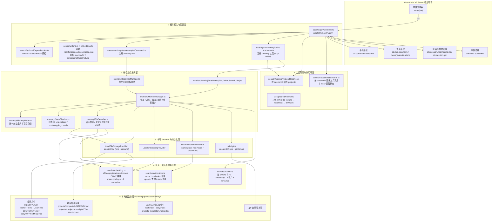
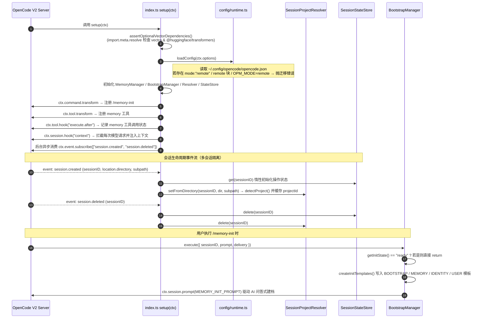
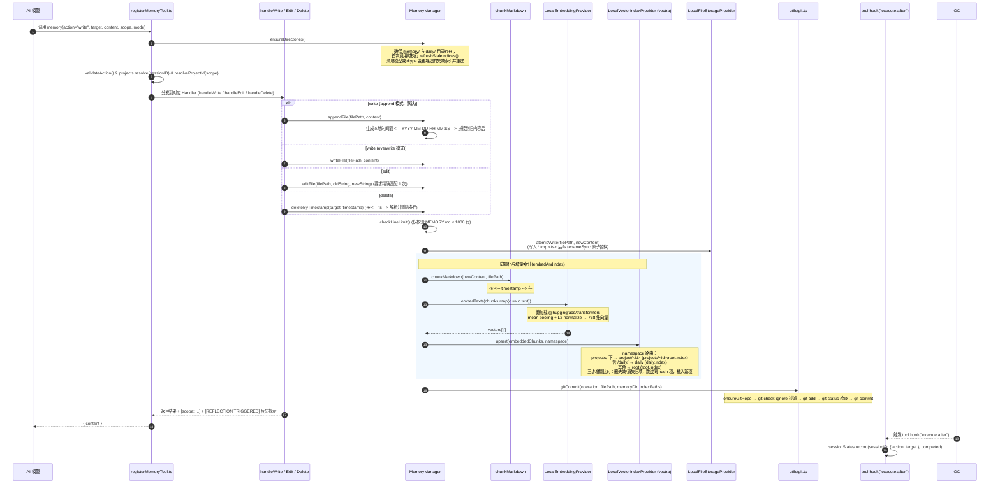
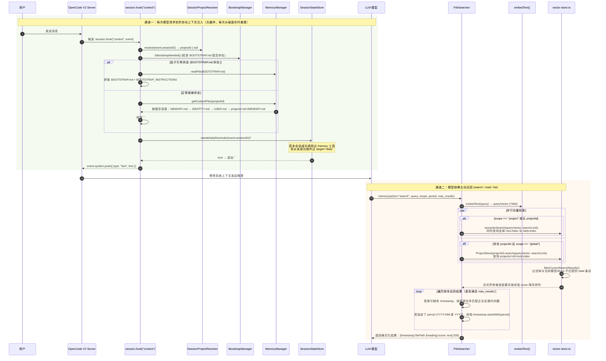

# `@devcxl/opencode-memory` 架构与工作流程全景指南

> 适用版本：`2.0.0-rc.1`（OpenCode V2 local-only）  
> 核心运行时：`@opencode/plugin@^2.3.0`、`zod@^4.1.8`、`@huggingface/transformers`、`vectra`

`@devcxl/opencode-memory` 是面向 **OpenCode V2** 的纯本地 Markdown 记忆插件。它以本地磁盘上的 Markdown 文件作为唯一真实数据源（Single Source of Truth），结合 **本地 ONNX 文本嵌入** 与 **Vectra 向量索引** 实现语义召回，并通过 **Git** 自动追踪每一次记忆变更。

> 注：旧版远程模式（Cloudflare Worker + Web 控制台）已在 2.0 中移除并迁移至 `@devcxl/cabbage-memory`。若配置中仍残留 `mode: "remote"`、`remote` 配置块或 `OPM_MODE=remote`，插件会在启动阶段直接抛出迁移错误以阻止静默降级。

---

## 1. 整体系统架构图



---

## 2. 磁盘目录与存储结构

记忆根目录由 `apps/plugin/src/config/runtime.ts` 中的 `getMemoryDir()` 解析：

- **Linux / macOS**：`~/.config/opencode/memory/`
- **Windows**：`%USERPROFILE%\AppData\Roaming\opencode\memory\`

```text
~/.config/opencode/memory/
├── .git/                         # 插件自动 git init 并提交每次变更
├── MEMORY.md                     # 全局长期记忆（上限 1000 行）
├── IDENTITY.md                   # AI 身份设定（人格、语言、行为规则）
├── USER.md                       # 用户画像（技术栈、偏好、称呼等）
├── BOOTSTRAP.md                  # 仅首次引导时存在，初始化完成后由 AI 删除
├── daily/
│   └── YYYY-MM-DD.md             # 全局每日任务日志
├── root.index/                   # vectra 索引：全局 MEMORY / IDENTITY / USER
├── daily.index/                  # vectra 索引：全局 daily/*.md
└── projects/
    └── <projectId>/              # 如 devcxl/opencode-memory 或 myproj.a1b2c3d4
        ├── MEMORY.md             # 项目级长期记忆（上限 1000 行）
        ├── daily/
        │   └── YYYY-MM-DD.md     # 项目级每日日志
        └── root.index/           # vectra 索引：该项目下的 MEMORY 与 daily
```

> 说明：向量索引目录（`*.index/`）属于**可重建的派生数据**；即使删除索引目录，原始记忆也不会丢失。

---

## 3. 插件核心工作流程（时序图）

插件的完整生命周期由以下 **3 条主链路** 组成：

1. **启动注册、事件监听与首次引导**
2. **记忆存储流程（写入、切片、向量化、原子落盘、Git 提交）**
3. **记忆召回流程（自动上下文注入 + 主动语义检索）**

### 3.1 插件启动、会话监听与 `/memory-init` 引导流程



#### 会话项目 `projectId` 探测逻辑（`apps/plugin/src/utils/projectDetector.ts`）

由于 OpenCode V2 的 Server 是多会话共享服务，`ctx.location` 只代表插件加载位置，不能代表各个会话所在的目录。因此插件通过 `SessionProjectResolver` 为每个 `sessionID` 独立解析所在目录并缓存 `projectId`：

1. **排除目录**：若目录是用户主目录 `$HOME`、以 `.` 开头的隐藏目录（如 `~/.config`），或位于 `memoryDir` 自身内部，返回 `null`（走全局记忆）。
2. **策略 1（优先）**：执行 `git remote get-url origin`，解析出 `owner/repo`（支持 HTTPS、SSH、`git@` 三种格式）。
3. **策略 2**：无 remote 的本地 git 仓库（含 worktree / submodule），通过 `git rev-parse --show-toplevel` 取仓库根目录名 + 路径 SHA256 前 8 位（如 `my-repo.a1b2c3d4`）。
4. **策略 3（兜底）**：普通非 git 目录，取 `basename(cwd)` + 路径 SHA256 前 8 位。

---

### 3.2 记忆存储流程（Write / Append / Edit / Delete）



#### 存储链路关键机制

1. **原子写入**：`atomicWrite()` 先写 `${filePath}.tmp.${Date.now()}`，再通过 `fs.renameSync()` 替换目标文件，防止异常中断导致 Markdown 损坏。
2. **Markdown 语义切片**：`chunkMarkdown()` 维护 `heading`（`##` / `###`）、`timestamp`（`<!-- YYYY-MM-DD HH:MM:SS -->`）与 `buffer` 状态，每遇到时间戳或标题就刷新为一个独立 `Chunk`，并计算 `sha256(filePath:heading:timestamp:text)` 用于增量去重。
3. **增量向量更新**：`upsertChunks()` 在 Vectra 索引中比对已有条目的 `hash` 与 `embeddingModel` / `embeddingDtype`，仅删除已失效或已移除的切片、跳过未变化的切片、插入新增切片。
4. **嵌入模型解析优先级**（`apps/plugin/src/config/embedding.ts`）：
   - L1：`~/.config/opencode/opencode.json` 中的插件 `options.embeddingModel`
   - L2：系统 locale 检测（`LANG` / `LC_ALL` / `LC_CTYPE` 以 `zh` 开头 → `Xenova/jina-embeddings-v2-base-zh`，768 维）
   - L3：环境变量 `OPM_EMBEDDING_MODEL`
   - L4：默认 `nomic-ai/nomic-embed-text-v1.5`（768 维）
   - 量化精度 `dtype` 按 `options.dtype` → `OPM_EMBEDDING_DTYPE` → 默认 `"fp32"` 解析（支持 `fp32`、`fp16`、`q8`、`q4`、`int8`、`uint8`）。
5. **嵌入容错**：`embedAndIndex()` 若遇到模型未初始化错误（`"not initialized"`），会静默跳过而不阻塞文件落盘与 Git 提交；向量索引会在后续模型可用时重建。
6. **Git 自动版本控制**：每次写入/编辑/删除都会调用 `gitCommit()`，将变更的 `.md` 文件及对应的索引文件一并提交到本地 `.git` 仓库。

---

### 3.3 记忆召回流程（双通道：自动上下文注入 + 主动语义检索）

记忆召回通过 **被动自动注入** 与 **主动工具查询** 两条通道协同工作：



---

## 4. 关键行为规则与设计边界

### 4.1 自动注入 vs 主动召回的边界

- **每次请求自动注入**：全局 `MEMORY.md`、`IDENTITY.md`、`USER.md`，以及当前会话对应的 `projects/<projectId>/MEMORY.md`。
- **不会自动注入**：`daily/YYYY-MM-DD.md` 与 `projects/<projectId>/daily/YYYY-MM-DD.md` 不会自动进入 system prompt，必须由模型在需要时通过 `memory(action="read", target="daily")` 或 `memory(action="search")` 主动读取/搜索。
- **无上下文缓存**：`session.hook("context")` 每次模型请求都会从磁盘重新读取记忆文件并拼接；`memory-awareness.md` 保持纯静态文本以保护模型侧 KV Cache 命中率。

### 4.2 `scope` 参数在各动作中的解析规则

| 操作类型                                 | 未传 `scope`（默认）                                            | `scope: "project"`                                           | `scope: "global"`                     | `scope: "all"`                              |
| :--------------------------------------- | :-------------------------------------------------------------- | :----------------------------------------------------------- | :------------------------------------ | :------------------------------------------ |
| **`read` / `write` / `edit` / `delete`** | 自动探测 `projectId`；探测到则操作项目目录，否则降级全局        | 同左（若无项目上下文仍降级全局）                             | 强制操作全局根目录文件                | 不适用（等同自动探测）                      |
| **`search`**                             | 有 `projectId` 时等同 `"all"`，无 `projectId` 时等同 `"global"` | 仅查 `projects/<id>/root.index`（无 `projectId` 时降级全局） | 仅查全局 `root.index` + `daily.index` | 合并检索全局 + 当前项目索引，按得分统一排序 |

### 4.3 初始化状态机（`apps/plugin/src/memory/StateChecker.ts`）

```text
getInitState() 状态判定优先级：
├─ BOOTSTRAP.md 存在                           → "bootstrapping"
├─ MEMORY.md 不存在 / 为空 / 全是模板行         → "uninitialized"
├─ IDENTITY.md & USER.md 均已填写非占位符内容   → "ready"
└─ 其他情况                                     → "uninitialized"
```

### 4.4 代码目录职责速查

| 模块路径                                                   | 核心职责                                                                                        |
| :--------------------------------------------------------- | :---------------------------------------------------------------------------------------------- |
| `apps/plugin/src/index.ts`                                 | 插件入口：`Plugin.define`、依赖预检、命令/工具/Hook/事件订阅注册                                |
| `apps/plugin/src/config/runtime.ts`                        | 解析 `~/.config/opencode/opencode.json`、确定 `memoryDir`、远程配置迁移守卫                     |
| `apps/plugin/src/config/embedding.ts`                      | 嵌入模型与量化 `dtype` 优先级解析                                                               |
| `apps/plugin/src/commands/registerMemoryInitCommand.ts`    | 注册 `/memory-init` 命令，触发模板创建与首次引导                                                |
| `apps/plugin/src/tool/registerMemoryTool.ts` & `schema.ts` | 注册 `memory` 工具（Zod 4 schema）与 6 个 action 的参数分发                                     |
| `apps/plugin/src/handlers/`                                | `read` / `write` / `edit` / `delete` / `search` / `list` 六个动作处理器                         |
| `apps/plugin/src/session/`                                 | `SessionProjectResolver`（会话→项目映射缓存）与 `SessionStateStore`（daily 提醒追踪）           |
| `apps/plugin/src/memory/`                                  | `MemoryManager`、`MemoryPaths`、`StateChecker`、`BootstrapManager`、`FileSearcher`、`templates` |
| `apps/plugin/src/search/`                                  | `optionalDependencies`、`chunker`、`embedding`、`vector-store`                                  |
| `apps/plugin/src/providers/local/`                         | 本地文件、嵌入、向量索引三大 Provider 实现（测试可替换 seam）                                   |
| `apps/plugin/src/utils/`                                   | `atomicWrite`、`git`、`projectDetector`、`timestampParser`、`validation`、`defaultProject`      |
