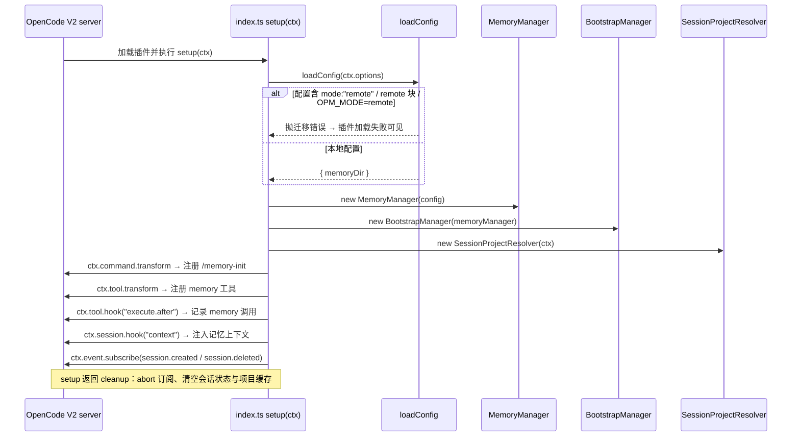
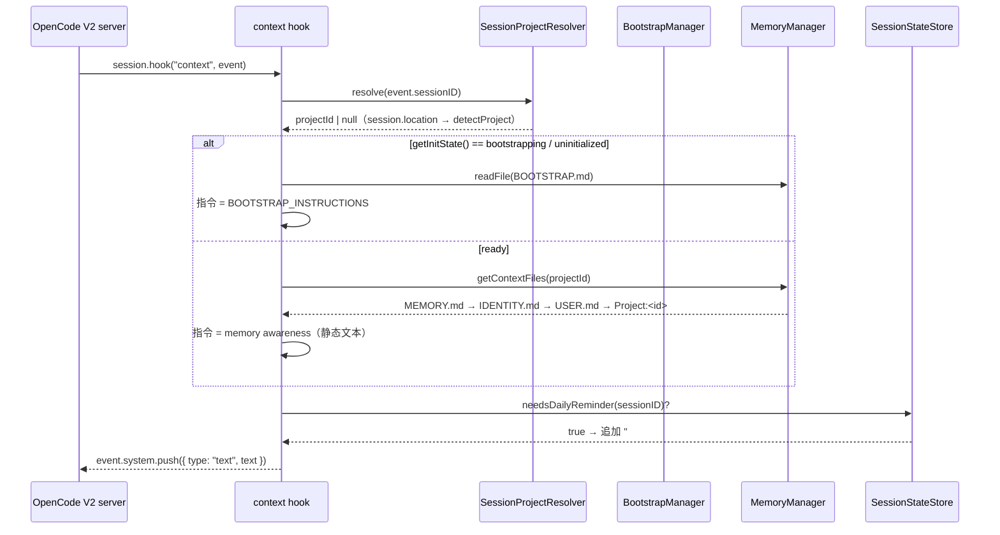
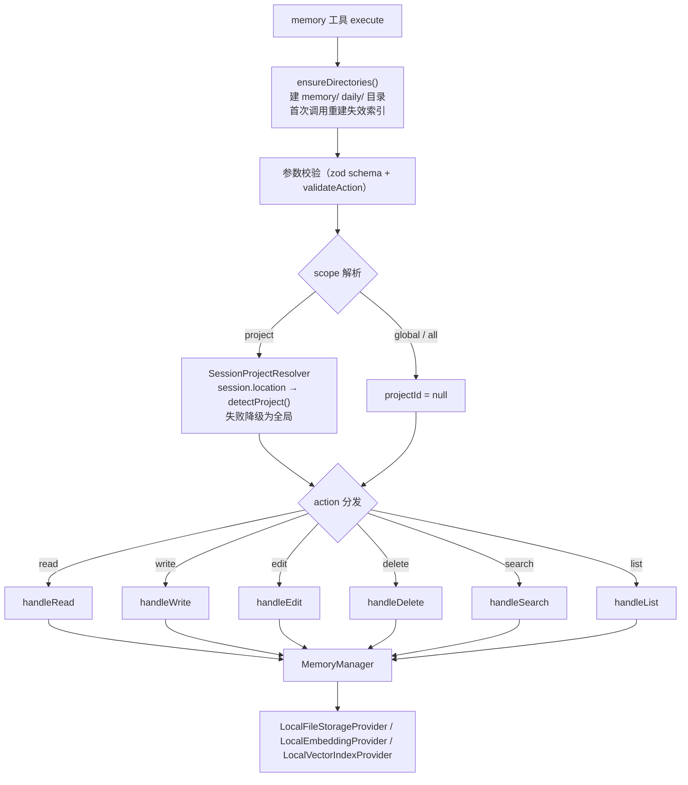
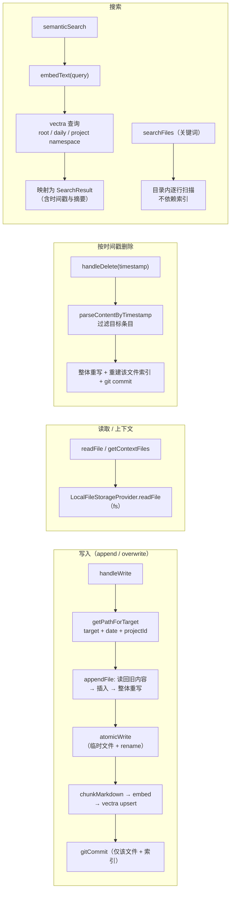

# opencode-memory 本地插件流程

> 版本: v2.0（local-only） | 日期: 2026-11-15
> 基于 OpenCode V2 插件 API (`@opencode/plugin@2.3.0`)

本文件只描述 2.0.0 的实际运行路径：**单个本地插件 + 本地文件系统**。远程 Provider、Cloudflare
Worker、Web 管理台与共享包已在 2.0 中删除，相关流程见 `@devcxl/cabbage-memory`。

---

## 1. 系统总览

```mermaid
flowchart TB
    subgraph OC["OpenCode V2 server"]
        SERVER[插件加载器]
    end

    subgraph Plugin["@devcxl/opencode-memory (apps/plugin)"]
        ENTRY["index.ts<br/>Plugin.define({ id, setup })"]
        CONFIG["loadConfig(ctx.options)<br/>config/runtime.ts"]
        MM["MemoryManager"]
        STATE["StateChecker"]
        SEARCHER["FileSearcher"]
        BOOT["BootstrapManager"]
        RESOLVER["SessionProjectResolver"]
        SESS["SessionStateStore"]
        EMB["LocalEmbeddingProvider<br/>@huggingface/transformers"]
        VEC["LocalVectorIndexProvider<br/>vectra"]
        FS["LocalFileStorageProvider<br/>atomicWrite"]
    end

    subgraph Disk["本地磁盘（唯一数据源）"]
        MEM[("~/.config/opencode/memory/<br/>MEMORY / IDENTITY / USER<br/>daily/ · projects/")]
        IDX[("root.index + daily.index<br/>vectra 本地索引")]
        GIT[(".git<br/>每次写入自动 commit")]
    end

    SERVER -->|setup(ctx)| ENTRY
    ENTRY --> CONFIG
    ENTRY --> MM
    ENTRY --> BOOT
    ENTRY --> RESOLVER
    ENTRY --> SESS
    MM --> STATE
    MM --> SEARCHER
    MM --> FS
    MM --> EMB
    MM --> VEC
    FS --> MEM
    VEC --> IDX
    VEC --> EMB
    MM -->|gitCommit| GIT
    STATE --> MEM
```

要点：

- 没有网络调用，也没有第二份数据副本；`memoryDir` 是唯一持久化目标。
- `MemoryManager` 默认自建三个本地 Provider，测试可注入替身（Provider 仅作为测试 seam 保留）。

---

## 2. 插件生命周期



- 插件 id 固定为 `devcxl.opencode-memory`。
- 配置错误在 setup 阶段抛出（包括远程配置），不吞异常，保证"插件没加载"是可观测的。
- 事件订阅在后台任务中消费；`session.created` 缓存 location，`session.deleted` 清理状态。

---

## 3. context 注入（每次模型请求）



- 每次请求都重新读文件、重新拼装，**没有上下文缓存**（已知限制）。
- 指令部分是静态文本，不插入日期等动态内容，避免模型侧 KV cache 失效。
- 项目上下文来自 `projects/<projectId>/MEMORY.md`；项目检测失败时只用全局文件。
- V1 的 `session.idle` TUI toast 在 V2 没有等价能力，因此改为系统上下文里的 `Memory Reminder`。

---

## 4. memory 工具调用分发



执行后由 `tool.execute.after` 记录本次调用（action/target/成功与否），供下一次 context hook
判断是否需要 `Memory Reminder`。

---

## 5. 本地读写路径



索引与数据的关系：

| 索引文件                  | 覆盖范围                                     |
| ------------------------- | -------------------------------------------- |
| `root.index`              | 全局 `MEMORY.md` / `IDENTITY.md` / `USER.md` |
| `daily.index`             | 全局 `daily/*.md`                            |
| `projects/<id>/` 下的索引 | 项目级 MEMORY 与 daily                       |

- 索引是可重建的派生数据；删除 `*.index` 不会丢记忆。
- 嵌入模型变化（`embeddingModel` / `dtype` 改变）后，首次工具调用会重建失效索引。
- 嵌入失败只影响 `search` 命中率，不阻塞写入持久化。

---

## 6. 目录结构与职责

| 路径                                         | 职责                                                |
| -------------------------------------------- | --------------------------------------------------- |
| `apps/plugin/src/index.ts`                   | 插件入口：setup、命令/工具注册、hooks、事件订阅     |
| `apps/plugin/src/config/runtime.ts`          | 配置解析、memory 目录、远程配置迁移守卫             |
| `apps/plugin/src/config/embedding.ts`        | 嵌入模型与 dtype 解析（配置 / locale / 环境变量）   |
| `apps/plugin/src/memory/MemoryManager.ts`    | 核心读写、追加/编辑/删除、路径解析、索引与 git 提交 |
| `apps/plugin/src/memory/StateChecker.ts`     | 初始化状态：uninitialized / bootstrapping / ready   |
| `apps/plugin/src/memory/BootstrapManager.ts` | 首次引导模板创建                                    |
| `apps/plugin/src/memory/FileSearcher.ts`     | 关键词搜索、语义搜索、文件列举                      |
| `apps/plugin/src/handlers/`                  | 6 个 action 的入参处理与结果格式化                  |
| `apps/plugin/src/providers/local/`           | 本地文件 / 嵌入 / 向量索引实现                      |
| `apps/plugin/src/search/`                    | chunker、embedding pipeline、vectra 存储            |
| `apps/plugin/src/session/`                   | session → project 解析与缓存、操作状态记录          |
| `apps/plugin/src/tool/`                      | `memory` 工具注册与 schema                          |
| `apps/plugin/src/commands/`                  | `/memory-init` 注册                                 |
| `apps/plugin/src/release/`                   | dist-tag 推导（发布流程唯一实现）                   |

---

## 7. 关键路径速查

- 插件加载：`OpenCode server → index.ts setup(ctx) → loadConfig → 注册 command/tool/hooks`
- 上下文注入：`session.hook("context") → projectId → BOOTSTRAP.md 或 MEMORY/IDENTITY/USER/PROJECT → event.system.push`
- 工具调用：`memory execute → ensureDirectories → 校验 → action 分发 → MemoryManager → 本地 Provider`
- 写入落地：`appendFile → atomicWrite → embed → vectra upsert → git commit`
- 语义搜索：`embedText → vectra query（root / daily / project） → SearchResult`
- 初始化：`/memory-init → createInitTemplates → ctx.session.prompt`；已 ready 时直接返回
- 远程配置：`mode: "remote"` / `remote` / `OPM_MODE=remote` → setup 抛迁移错误 → 指向 `@devcxl/cabbage-memory`
